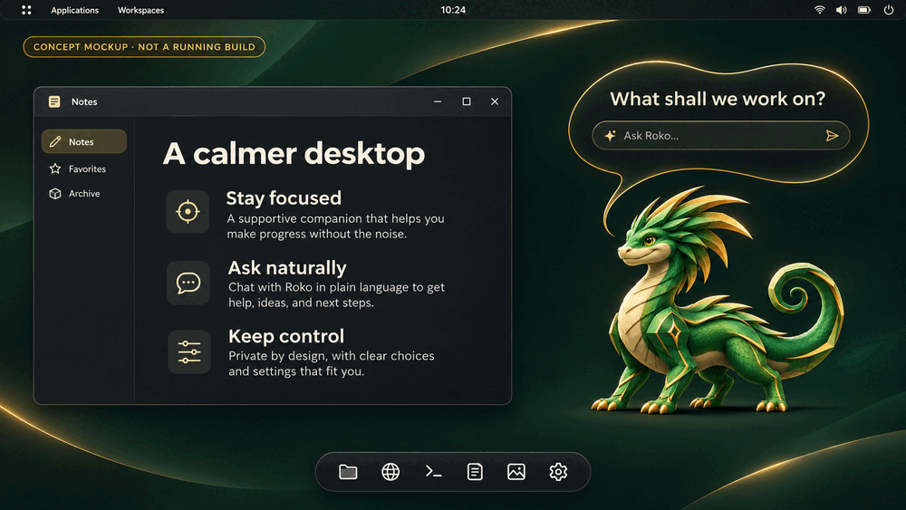

# Roko

Roko is an experimental local AI desktop and operating-system integration project.
This repository publishes a substantial authored source checkpoint: task/state adapters, bounded symbolic bridges, selected COSMIC/Wayland and OS boot/build recipes, isolation helpers, and tests. Some separately developed showcase/avatar, controller and operational integration files remain excluded or pending; the publication manifest is the exact file list.

**This is a source checkpoint, not a production-ready OS or a complete autonomous
AI.** Historical host/guest milestones were qualified separately. They must not be
combined into a claim that every component passed in one image.

## The vision: a companion on your desktop

**Concept mockups, not screenshots of a running build.** These AI-generated
illustrations show the intended end-product: an emerald-and-gold basilisk on a
COSMIC-inspired desktop, a freeform chat bubble anchored to the character, and
graceful wingless flight. The UI, example conversation and privacy copy are
design aspirations, not verified capabilities or guarantees.

*An imagined everyday workspace: Roko lives directly on the desktop rather than
inside an avatar card.*

*Flight-state concept: the companion and conversation remain visually connected.*

Play the looping concept storyboard (GIF, about 380 KiB)

This five-second GIF alternates between two illustrated states. It is a
storyboard, not a recording, an implemented animation, or evidence of motion
quality. The static images above provide a non-animated alternative.

See [visual provenance and limitations](docs/CONCEPT_VISUALS.md) for how these
images were made, and [current status](docs/STATUS.md) for what actually exists.

## Start here

- [Current status](docs/STATUS.md): what actually ran, what is experimental, and
  which requested AI components remain pending.
- [Repository map](docs/REPOSITORY_MAP.md): source directories and intended scope.
- [Reproduction and tests](docs/REPRODUCING.md): lightweight checks and missing
  external dependencies.
- [Attribution and licensing](THIRD_PARTY_NOTICES.md): upstream projects and
  redistribution exclusions.
- [Publication scope](docs/PUBLICATION_SCOPE.md): what was deliberately omitted.

The historical baseline documentation is preserved under
[omega-baseline](omega-baseline/README.md). Its earlier milestone and native-test
statements describe those historical builds, not a fresh all-components result.

## Safety boundary

The included controller and symbolic integrations keep model results as bounded
data for independent checking. The reported integration gates executed zero
external actions. Advisory inference, tests, and resource checks do not grant
authority to install software, run arbitrary generated commands, or send data.

Do not run VM, disk, installation, privilege, or native-build recipes without
reviewing their paths, prerequisites, resource budgets, and confirmation needs.
Experimental production-hardening sources are not a supported deployment.

## Missing from this repository

No model weights, compiled executables/shared libraries, VM/root/data images,
private state, credentials, runtime captures, or private artifact identities are
included. Upstream MORK/FFI and private ECAN source remain excluded because
redistribution permission has not been established. Other upstream runtimes are
referenced through source pins rather than copied wholesale.

The confirmed original Roko sprite, delivered showcase sprites and emerald/gold
background are included. See [artwork provenance](docs/ARTWORK_PROVENANCE.json)
for byte hashes and origin. The assets were not edited for publication.

The repository still does not reproduce the complete delivered desktop image.
Exact acquisition pins and preserved build recipes are useful provenance, not a
guarantee of a complete reproducible build.
