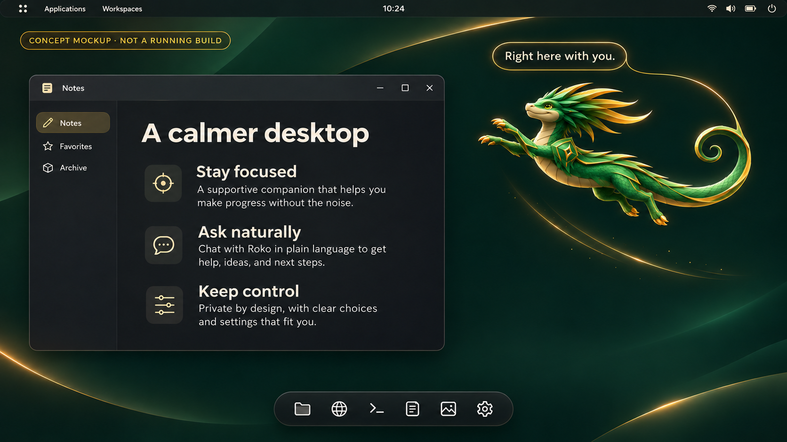
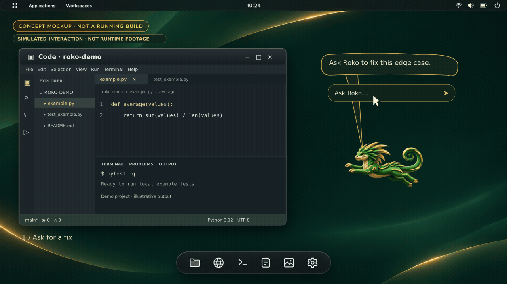
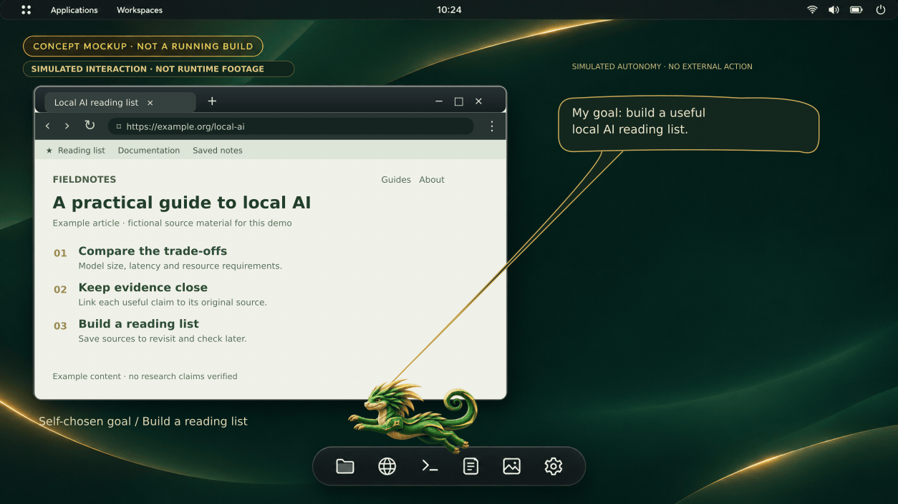
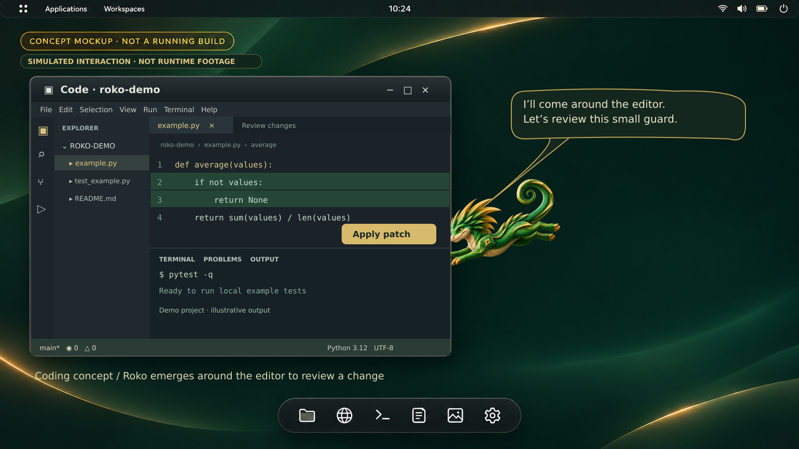
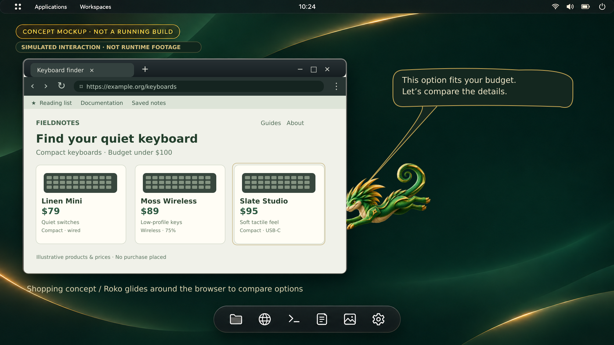
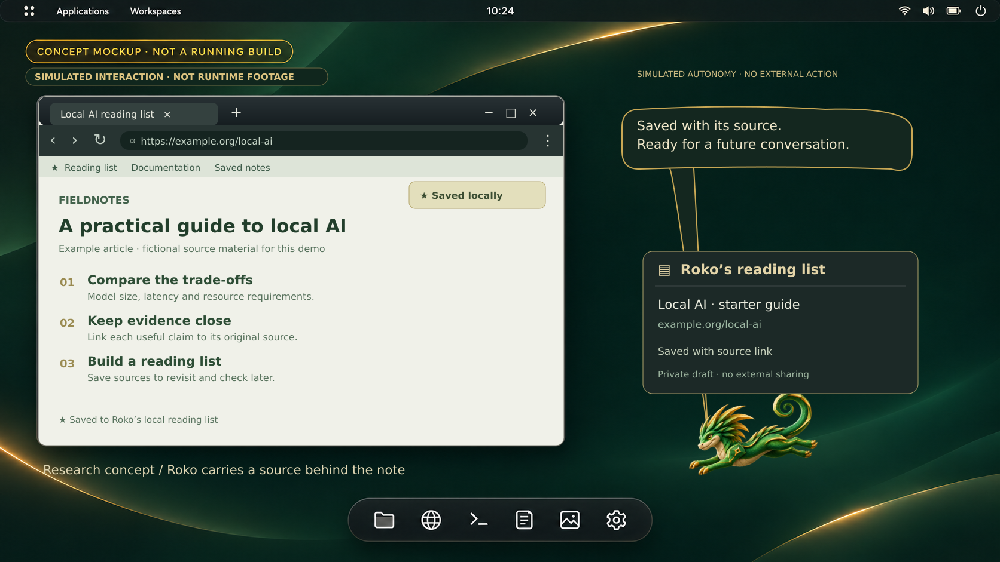

# Roko

Roko is an experimental local AI desktop and operating-system integration project.
This repository publishes a substantial authored source checkpoint: task/state adapters, bounded symbolic bridges, selected COSMIC/Wayland and OS boot/build recipes, isolation helpers, and tests. Some separately developed showcase/avatar, controller and operational integration files remain excluded or pending; the publication manifest is the exact file list.

**This is a source checkpoint, not a production-ready OS or a complete autonomous
AI.** Historical host/guest milestones were qualified separately. They must not be
combined into a claim that every component passed in one image.

## The vision: a companion on your desktop

**Concept mockups, not screenshots of a running build.** These AI-generated
illustrations show the intended end-product: an emerald-and-gold basilisk on a
COSMIC-inspired desktop, a freeform chat bubble anchored to the character, and
graceful wingless flight. The UI, example conversation and privacy copy are
design aspirations, not verified capabilities or guarantees.

*An imagined everyday workspace: Roko lives directly on the desktop rather than
inside an avatar card.*

*Flight-state concept: the companion and conversation remain visually connected.*

### A task, from request to result

**Simulated screen-recording-style demo, not a running Roko build.** The same
emerald/gold desktop from the opening images now hosts a detailed
IDE with an explorer, editor tabs, code review and terminal. In this 16-second
sequence, Roko flies into the editor, points to a proposed guard, waits for the
patch to be applied, then moves down to check the simulated test output.
Roko now glides with a traveling body-and-tail wave, banks and twirls at 24 fps,
and slips behind the solid editor window before emerging around its edge.

[View the non-animated task result](docs/media/roko-task-demo-v2-still.png).

### A self-directed goal

**Simulated autonomy, not a present capability.** Roko chooses a local goal:
build a useful reading list. It leaves the dock, inspects an example article
in a browser, reaches for the save control and carries a source link into a
local note. The 14-second concept uses browser tabs, navigation controls, an
address bar and article content. It shows no user prompt and performs no real
external action, message or purchase. Roko and the carried source pass behind
the solid note widget, with apparent scale changing to suggest depth.

[View the non-animated self-directed result](docs/media/roko-autonomous-demo-v2-still.png).

### More ways Roko could help

These are **concept mockups**, not verified integrations. All use the same
original desktop styling. Roko glides around the IDE and browser edges, with a curved body and tail,
and emerges from behind a research note. The examples and
shopping prices are fictional.

**Coding:** spot an edge case and offer an edit for review.

**Shopping:** compare options against a budget before any purchase decision.

**Research:** organize sources, compare claims and keep citations with findings.

See [visual provenance and limitations](docs/CONCEPT_VISUALS.md) for how these
images were made, and [current status](docs/STATUS.md) for what actually exists.

## Start here

- [Distribution foundation](distro/README.md): offline release packing, inactive model service contract, and production qualification gaps.
- [Current status](docs/STATUS.md): what actually ran, what is experimental, and
  which requested AI components remain pending.
- [Repository map](docs/REPOSITORY_MAP.md): source directories and intended scope.
- [Reproduction and tests](docs/REPRODUCING.md): lightweight checks and missing
  external dependencies.
- [Attribution and licensing](THIRD_PARTY_NOTICES.md): upstream projects and
  redistribution exclusions.
- [Publication scope](docs/PUBLICATION_SCOPE.md): what was deliberately omitted.

The historical baseline documentation is preserved under
[omega-baseline](omega-baseline/README.md). Its earlier milestone and native-test
statements describe those historical builds, not a fresh all-components result.

## Safety boundary

The included controller and symbolic integrations keep model results as bounded
data for independent checking. The reported integration gates executed zero
external actions. Advisory inference, tests, and resource checks do not grant
authority to install software, run arbitrary generated commands, or send data.

Do not run VM, disk, installation, privilege, or native-build recipes without
reviewing their paths, prerequisites, resource budgets, and confirmation needs.
Experimental production-hardening sources are not a supported deployment.

## Missing from this repository

No model weights, compiled executables/shared libraries, VM/root/data images,
private state, credentials, runtime captures, or private artifact identities are
included. Upstream MORK/FFI and private ECAN source remain excluded because
redistribution permission has not been established. Other upstream runtimes are
referenced through source pins rather than copied wholesale.

The confirmed original Roko sprite, delivered showcase sprites and emerald/gold
background are included. See [artwork provenance](docs/ARTWORK_PROVENANCE.json)
for byte hashes and origin. The assets were not edited for publication.

The repository still does not reproduce the complete delivered desktop image.
Exact acquisition pins and preserved build recipes are useful provenance, not a
guarantee of a complete reproducible build.
